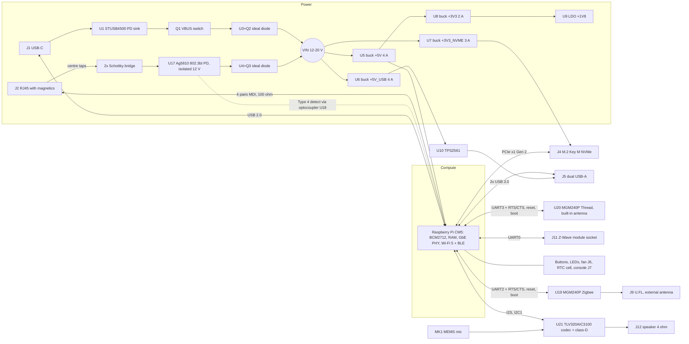

# System architecture

Tahanan Hub rev A is a carrier board for the Raspberry Pi Compute Module 5 in a 167 x 112 x 31 mm
enclosure. The single source of truth for the circuit is `hardware/gen/design.py`.

## Block diagram

## Interfaces

| Function | Implementation | Connector |
|---|---|---|
| Ethernet | 1000BASE-T, PHY on CM5, Würth 7499511001A jack with magnetics | J2 |
| PoE | 802.3bt powered device, Silvertel Ag5810, 1500 V isolation | J2 |
| USB-C power | USB PD sink, 15 V or 20 V contract, 45 W charger minimum | J1 |
| Wi-Fi and Bluetooth | 2.4 and 5 GHz 802.11ac, BLE 5.0, on CM5. PCB antenna or U.FL | on module |
| Zigbee | MGM240P (EFR32MG24), +20 dBm, external antenna | J9 to RP-SMA |
| Thread and Matter | MGM240P as OpenThread radio co-processor. Matter runs over Thread, Wi-Fi and Ethernet | built-in antenna |
| Z-Wave | Socket for a Raspberry Pi header Z-Wave 800 module | J11 |
| Storage | M.2 Key M, 2242 and 2280, NVMe | J4, bottom side |
| USB host | 2x USB 3.0 Type-A, about 1.2 A limit each | J5 |
| Audio | TLV320AIC3100 codec, one analog MEMS microphone, 2.5 W class-D into 4 ohm | MK1, J12 |
| Service | 3.3 V serial console, RPIBOOT button, SWD pads for both radios | J7, SW2, J8, J10 |

## Design decisions worth knowing

- **Two 802.15.4 radios.** Zigbee and Thread each get a dedicated radio and UART. Sharing one radio
  between the two stacks halves airtime for each and is the less reliable configuration.
- **Z-Wave as a plug-in module.** Z-Wave frequency and certification are regional. A socket keeps one
  board for all regions and uses modules that are already certified.
- **Input selection by voltage.** Both sources feed VIN through ideal-diode controllers. USB-C (15 or
  20 V) is always above PoE (12 V), so it takes the load when present. Neither can feed the other.
- **PD contract gates the USB-C input.** Q1 only closes after a contract above 5 V, so a 5 V-only
  charger cannot half-power the rails.
- **Codec is the audio clock master.** Capture and playback share one clock, which keeps the echo
  canceller's reference aligned with the microphone signal.
- **Hardware microphone mute.** SW4 removes microphone power. Software can read the state but cannot
  override it.

## GPIO map

| GPIO | Use | GPIO | Use |
|---|---|---|---|
| 2, 3 | I2C1: codec 0x18, PD controller 0x28 | 16 | Codec reset, active low |
| 4-7 | UART2 Zigbee: TX, RX, CTS, RTS | 17 | User button, active low |
| 8-11 | UART3 Thread: TX, RX, CTS, RTS | 18-21 | I2S: BCLK, WS, data in, data out |
| 12, 13 | UART4 console: TX, RX | 22, 23 | Zigbee reset, bootloader entry |
| 14, 15 | UART0 Z-Wave: TX, RX | 24, 25 | Thread reset, bootloader entry |
| 26 | User LED | 27 | Microphone-enabled sense |
| 34 (CAM_GPIO0) | PoE Type 4 detect, active low | | |

## Radio coexistence

Three 2.4 GHz transmitters share one enclosure: Wi-Fi and BLE on the CM5, Zigbee, and Thread.

- Placement: the Thread antenna is at the front-left corner, the CM5 antenna at the right edge about
  125 mm away, and the Zigbee antenna is external.
- No packet-traffic-arbitration wiring exists between the radios, because the CM5 does not expose
  coexistence signals. Coexistence relies on separation and channel planning.
- Recommended deployment: Ethernet for the uplink, Wi-Fi on 5 GHz, Zigbee on channel 15, 20 or 25,
  Thread on a channel at least 15 MHz away from Zigbee.
- Heavy 2.4 GHz Wi-Fi traffic from the hub itself will raise 802.15.4 packet loss. This must be
  quantified in validation test RF-07.
